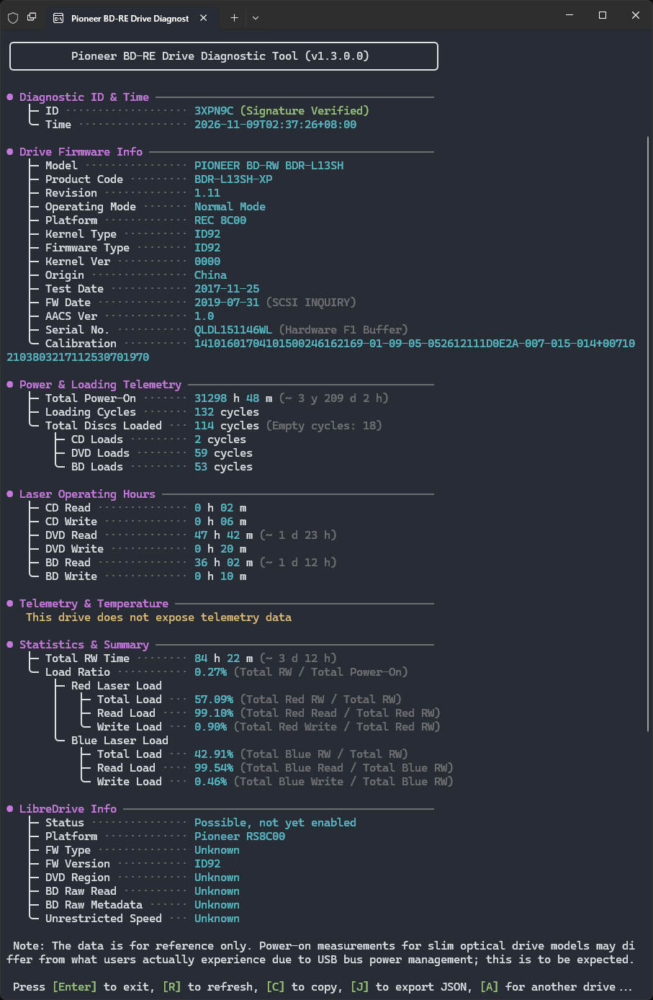

# PION Blue-ray Optical Drive Diagnostic Tool

This software was developed by an anonymous member of the community and is designed to provide Blu-ray enthusiasts with valuable information about the internals of "PION" Blu-ray drives, serving as a reference for identifying and diagnosing various drive issues.

The software can provide information on most modern Blu-ray drives manufactured by "PION", including:

1. Product code
2. Firmware model
3. Platform
4. Date of Manufacture
5. Power-On and Load times
6. ...

Please note that this software is completely free to use and distribute. Be careful not to fall for scams.

## Usage tips

### Improved Font, Symbol, and Color Rendering

On Windows 10 and later versions, you can install Windows Terminal to enjoy improved rendering. Choose one of the following installation methods:

1. Search for "Windows Terminal" in the Microsoft Store or go directly to this link: <https://apps.microsoft.com/detail/9n0dx20hk701>
2. Quickly install via the Windows command line (press Win + R, type "cmd," and press Enter to open): `winget install Microsoft.WindowsTerminal`

### Reading LibreDrive Information

After installing MakeMKV in the default folder, the application can read LibreDrive information from optical drives.

### Reading JSON Diagnostic Data

JSON diagnostic data exported by the tool can be re-read by the tool using the following methods:

1. Drag the JSON data file onto the tool.
2. Pass the path to the JSON data file to the tool via the command line, for example: `bdre-diag-tool.exe D:\Downloads\diag.json`

### Command-Line Arguments and Options

1. `-s` / `--silent`: Outputs results directly to the current terminal window without opening a new one, allowing for use with tools such as Windows sudo.
2. `-l` / `--lang`: Specifies the language used for output; the default is Chinese, but it switches to English in non-Chinese environments. Use `-l en` or `--lang=en` to switch to English output, and use `-l zh` or `--lang=zh` to switch to Chinese output.
3. `-d` / `--drive`: Specifies the drive letter of the optical drive, such as `-d E` or `--drive=E`.

## Copyright

CC BY-NC-SA 3.0
